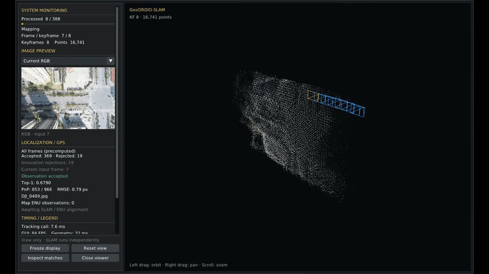
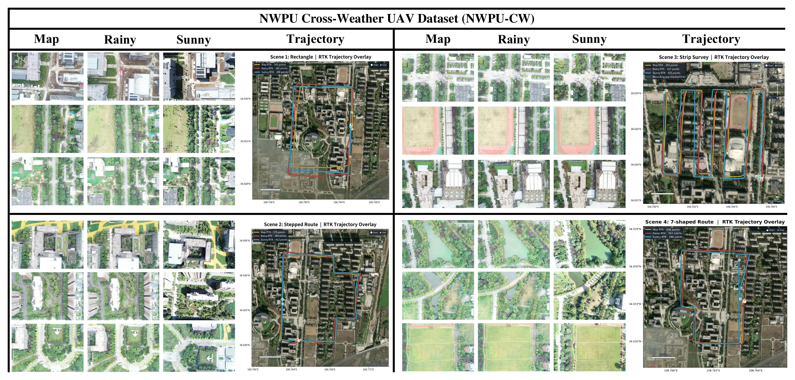

**English** | [简体中文](README.zh-CN.md)

# GAMA-SLAM

### Geographic Anchoring for Monocular Aerial Dense SLAM in GNSS-Limited Environments

Yisu Zhang · Tao Yang · Dongdong Li · Yuru Wu · Negaar Rezvanfar · Jing Li

Northwestern Polytechnical University · Xidian University

[Overview](#overview) · [NWPU-CW Dataset](#nwpu-cw-dataset) · [Release Plan](#release-plan) · [Demo](#demo)

**Dataset: release after paper acceptance** · **System demo: available**

*System demonstration: aerial imagery, dense reconstruction, and trajectory visualization.*

## Overview

GAMA-SLAM studies geographically referenced UAV sensing in GNSS-limited environments. The project focuses on continuous flight trajectories and the spatial association of observations collected across independent flights, supporting repeated aerial inspection.

This page provides a brief project introduction, system demonstrations, and an overview of the NWPU-CW dataset. Detailed research materials will be released after paper acceptance.

## NWPU-CW Dataset

**NWPU Cross-Weather UAV Dataset (NWPU-CW)** captures independent mapping and query flights at Northwestern Polytechnical University using a DJI Phantom 4 RTK. It covers four route geometries: rectangular, stepped, strip, and 7-shaped. Each route includes a cloudy mapping flight and separate sunny and rainy query flights, with cross-flight changes in viewpoint, appearance, and occlusion.

**12 sequences · 4,530 images · 1805 × 1203 resolution · 0.5 Hz nominal sampling rate**

*NWPU-CW across independent flights. Upper left: S1 (rectangular); lower left: S2 (stepped); upper right: S3 (strip); lower right: S4 (7-shaped). Each group shows mapping and query images alongside real-time kinematic (RTK) reference trajectories.*

### Sequence summary

| Sequence | Route | Role / condition | Images | Relative path (planned) |
| :--- | :--- | :--- | ---: | :--- |
| S1-Map | Rectangular | Mapping / cloudy | 343 | `scene1_rectangular/map` |
| S1-Sunny | Rectangular | Query / sunny | 358 | `scene1_rectangular/sunny` |
| S1-Rainy | Rectangular | Query / rainy | 391 | `scene1_rectangular/rainy` |
| S2-Map | Stepped | Mapping / cloudy | 379 | `scene2_stepped/map` |
| S2-Sunny | Stepped | Query / sunny | 412 | `scene2_stepped/sunny` |
| S2-Rainy | Stepped | Query / rainy | 384 | `scene2_stepped/rainy` |
| S3-Map | Strip | Mapping / cloudy | 383 | `scene3_strip/map` |
| S3-Sunny | Strip | Query / sunny | 415 | `scene3_strip/sunny` |
| S3-Rainy | Strip | Query / rainy | 427 | `scene3_strip/rainy` |
| S4-Map | 7-shaped | Mapping / cloudy | 294 | `scene4_7shaped/map` |
| S4-Sunny | 7-shaped | Query / sunny | 380 | `scene4_7shaped/sunny` |
| S4-Rainy | 7-shaped | Query / rainy | 364 | `scene4_7shaped/rainy` |
| **Total** | **4 routes** | **4 mapping + 8 query sequences** | **4,530** | |

The four mapping sequences contain 1,399 images; the eight query sequences contain 3,131 images. The English paths above illustrate the planned release naming. The public release will confirm the final directory names.

> **Dataset availability:** We will release NWPU-CW and add the download link here after paper acceptance.

## Release Plan

The NWPU-CW dataset and its documentation will be released after paper acceptance. This page will be updated when the resources become available.

| Resource | Availability |
| :--- | :--- |
| System demonstration | Available on this page |
| NWPU-CW dataset and download link | After paper acceptance |
| Dataset documentation | After paper acceptance |

## Demo

The animation at the top of this page shows the system interface, dense reconstruction, and trajectory visualization.

[Watch the full video](assets/gama-slam-demo.mp4) · [View the full animation](video/slam.gif)

## Contact

For research enquiries, contact **Yisu Zhang**: [zhangyisu@mail.nwpu.edu.cn](mailto:zhangyisu@mail.nwpu.edu.cn).
