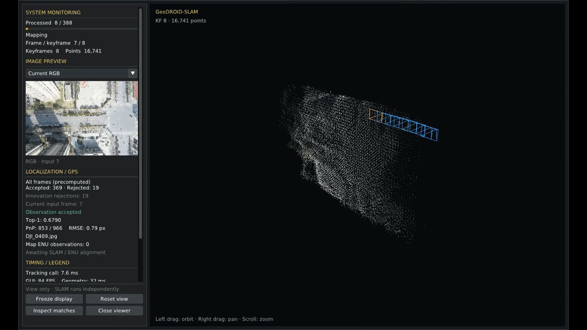
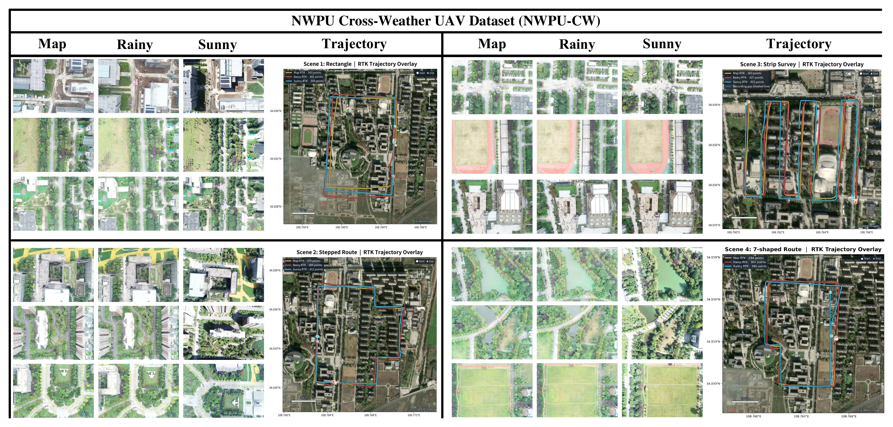

[English](README.md) | **简体中文**

# GAMA-SLAM

### 面向 GNSS 受限环境的地理锚定单目空中稠密 SLAM

*Geographic Anchoring for Monocular Aerial Dense SLAM in GNSS-Limited Environments*

Yisu Zhang · Tao Yang · Dongdong Li · Yuru Wu · Negaar Rezvanfar · Jing Li

西北工业大学 · 西安电子科技大学

[研究概述](#研究概述) · [NWPU-CW 数据集](#nwpu-cw-数据集) · [公开计划](#公开计划) · [系统演示](#系统演示)

**数据集：论文录用后公开** · **系统演示：已提供**

*系统演示：航拍图像、稠密重建与轨迹可视化。*

## 研究概述

GAMA-SLAM 面向 GNSS 受限环境中的无人机地理参考感知，关注连续飞行轨迹以及独立航次观测之间的空间关联，为重复空中巡检提供定位基础。

本页面仅提供项目简介、系统演示及 NWPU-CW 数据集概览。详细研究资料将在论文录用后公开。

## NWPU-CW 数据集

**NWPU 跨天气无人机数据集（NWPU Cross-Weather UAV Dataset，NWPU-CW）** 使用 DJI Phantom 4 RTK 在西北工业大学采集，包含独立的建图与查询航次。数据集覆盖矩形、阶梯形、条带形和七字形四种航线；每种航线包含一次多云建图飞行，以及分别采集的晴天和阴雨查询飞行，呈现跨航次的视角、外观与遮挡变化。

**12 条序列 · 4,530 张图像 · 1805 × 1203 分辨率 · 0.5 Hz 名义采样频率**

*NWPU-CW 独立航次展示。左上：S1（矩形）；左下：S2（阶梯形）；右上：S3（条带形）；右下：S4（七字形）。每组展示建图与查询图像，以及实时动态差分定位（RTK）参考轨迹。*

### 序列概览

| 序列 | 航线 | 用途 / 天气 | 图像数 | 相对路径（拟定） |
| :--- | :--- | :--- | ---: | :--- |
| S1-Map | 矩形 | 建图 / 多云 | 343 | `scene1_rectangular/map` |
| S1-Sunny | 矩形 | 查询 / 晴天 | 358 | `scene1_rectangular/sunny` |
| S1-Rainy | 矩形 | 查询 / 阴雨 | 391 | `scene1_rectangular/rainy` |
| S2-Map | 阶梯形 | 建图 / 多云 | 379 | `scene2_stepped/map` |
| S2-Sunny | 阶梯形 | 查询 / 晴天 | 412 | `scene2_stepped/sunny` |
| S2-Rainy | 阶梯形 | 查询 / 阴雨 | 384 | `scene2_stepped/rainy` |
| S3-Map | 条带形 | 建图 / 多云 | 383 | `scene3_strip/map` |
| S3-Sunny | 条带形 | 查询 / 晴天 | 415 | `scene3_strip/sunny` |
| S3-Rainy | 条带形 | 查询 / 阴雨 | 427 | `scene3_strip/rainy` |
| S4-Map | 七字形 | 建图 / 多云 | 294 | `scene4_7shaped/map` |
| S4-Sunny | 七字形 | 查询 / 晴天 | 380 | `scene4_7shaped/sunny` |
| S4-Rainy | 七字形 | 查询 / 阴雨 | 364 | `scene4_7shaped/rainy` |
| **合计** | **4 种航线** | **4 条建图 + 8 条查询序列** | **4,530** | |

4 条建图序列共含 1,399 张图像，8 条查询序列共含 3,131 张图像。表中英文路径用于展示拟定的发布命名，最终目录名称以正式发布版本为准。

> **数据集公开安排：** NWPU-CW 将在论文录用后公开，届时在此页面提供下载链接。

## 公开计划

NWPU-CW 数据集及其说明文档将在论文录用后公开，届时更新本页面中的资源链接。

| 资源 | 公开时间 |
| :--- | :--- |
| 系统演示 | 已在本页面提供 |
| NWPU-CW 数据集与下载链接 | 论文录用后 |
| 数据集说明文档 | 论文录用后 |

## 系统演示

页面顶部动图展示了系统界面、稠密重建与轨迹可视化。

[观看完整视频](assets/gama-slam-demo.mp4) · [查看完整动图](video/slam.gif)

## 联系方式

科研交流请联系 **Yisu Zhang**：[zhangyisu@mail.nwpu.edu.cn](mailto:zhangyisu@mail.nwpu.edu.cn)。
